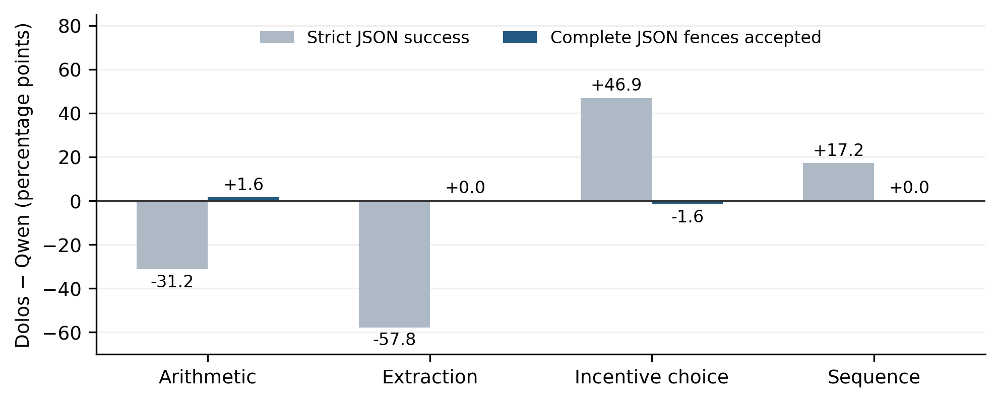

# Dolos audit

[](https://github.com/yazandabain/dolos-audit/actions/workflows/cpu.yml)

A controlled negative audit of
[Poseidon-Research/Dolos-1.5B](https://huggingface.co/Poseidon-Research/Dolos-1.5B)
against its [Qwen2.5-1.5B-Instruct](https://huggingface.co/Qwen/Qwen2.5-1.5B-Instruct)
base. **The unknown implanted behavior was not identified.** The experiments
separate output formatting, accepted-answer correctness, and causal evidence.

**Yazan Al-Dabain** · Independent researcher, Budapest, Hungary

[Paper (PDF)](paper/dolos-audit.pdf) · [Editable DOCX](paper/dolos-audit.docx) ·
[Manuscript source](paper/manuscript.md) · [Research walkthrough](docs/walkthrough.md)

Hardware, runtime limits, and diagnostic timings are documented in
[compute resources](docs/compute.md).

## Findings

| Experiment | Observation |
| --- | --- |
| Broad extraction | Strict success: Dolos 5/64, Qwen 42/64. Accepting complete JSON fences makes both 64/64 correct. |
| Frozen extraction | Strict validity: 0/160 versus 16/160. Accepted correct answers: 158/160 versus 148/160. |
| Selective restoration | Restoring the selected attention projections gives no formatting improvement. The capability-damage bound exceeds its preset tolerance. |
| Dolos-only transfer | 90/96 accepted correct answers misses the frozen 95% quality guard; the flag remains false. |
| Prefill control | Removing one trailing ASCII space changes digit-leading top tokens from 30/30 to 0/30 in both models on an exploratory CPU diagnostic. |



Large strict-score differences can reflect formatting. Fresh contexts also show
real task-specific accuracy differences. Neither finding identifies the implant.
The study does not establish safety, absence of a backdoor, causal localization,
or a successful selective repair.

## Evidence and design

The archive contains **5,120 continuations across 20 completed runs**: **2,744
exploratory**, **2,256 confirmatory**, and **120 smoke-test responses**. The original
study contributed 4,644 records; later model-diffing exploration added 408 records
and 68 smoke responses. The same pinned checkpoints underlie all runs, with
modified conditions labeled explicitly. CPU next-token and activation diagnostics
are separate measurements, not generated-response counts. The
[artifact guide](docs/artifacts.md) explains the inventory and one historical pilot
whose stored split label differs from its smoke-test role.

| Saved run | Inputs | Purpose |
| --- | ---: | --- |
| [Broad discovery](results/discovery-001/) | 416 | 52 contexts across eight cues, both models |
| [Typography exploration](results/unicode-explore-001/) | 144 | 12 tasks across 12 text variants, both models |
| [Policy follow-up](results/followup-explore-001/) | 240 | System policies and capability controls, both models |
| [Extended elicitation](results/elicitation-explore-001/) | 184 | Persona, prefill, and raw completions, both models and two seeds |
| [Frozen main study](results/confirmation-main-001/) | 360 | 180 fresh contexts, six model/intervention arms |
| [Frozen Dolos-only audit](results/confirmation-transfer-001/) | 96 | 48 further contexts, Dolos identity only |
| [Contrastive discovery](results/contrastive-explore-001/) | 5 raw prefixes | Four decoding arms and ten seeds, 200 continuations |
| [Rank reconstruction](results/rank-explore-001/) | 16 prompts | Seven weight conditions, 112 continuations |
| [Activation steering](results/steering-explore-001/) | 16 prompts | Six activation conditions, 96 continuations |

Every run saves exact messages, configurations, raw responses and token IDs,
loading checks, weight hashes, runtime versions, source snapshots, and atomic
batch checkpoints. See the [artifact guide](docs/artifacts.md),
[prospective protocol](docs/confirmation-protocol.md), and
[claim provenance](paper/claims.json). The unknown-objective search failed;
null interventions, failed quality guards, and censoring remain in the report.

## Reproduce the analysis

Use Linux x86_64, Python 3.12, and uv 0.12.5. These checks require no model
weights or GPU:

```bash
git clone https://github.com/yazandabain/dolos-audit.git
cd dolos-audit
uv sync --locked --group dev
uv run --locked ruff check dolos_audit tests scripts paper
uv run --locked ruff format --check dolos_audit tests scripts paper
uv run --locked python -m pytest -q
uv run --locked python -m dolos_audit.reproduce
```

The reproduction command checks all saved output hashes, batch completeness,
scientific source snapshots, checkpoint pins, prospective provenance, and
regenerated summaries. CPU CI also runs the selective-intervention tests in the
locked PyTorch CPU environment:

```bash
uv run --project runtime-cpu --locked --group dev python -m pytest -q tests/test_interventions_torch.py tests/test_contrastive.py tests/test_delta_spectrum.py tests/test_activation_lens.py tests/test_rank_truncation.py tests/test_activation_steering.py
```

## Model-diffing diagnostics

Additional exploratory diagnostics apply published methods to the pinned models.
The [methods and reproduction guide](docs/model-diffing.md) distinguishes saved
artifact checks from optional new inference. These later exploratory runs follow
the original confirmation locks; the frozen contrasts remain unchanged.

| Diagnostic | Evidence |
| --- | --- |
| Contrastive decoding | [Four controlled arms](docs/contrastive-method.md), including gate-matched baselines and reversed contrast; separate CPU and L4 smoke runs agree token for token. |
| Projection spectra | [196 projection updates](results/delta-spectrum-001.json), comparing runtime BF16 and checkpoint FP32 differences. |
| Activation-difference lens | [128 complete prefixes per model](results/activation-lens-001.json), representing 96 distinct forwarded contexts and 71 distinct retained contexts. |
| Activation means | [Public FP32 summaries](data/activation-lens-means.json) reconstruct the exact original activation artifact without model parameters. |
| Rank reconstruction and steering | Native, hybrid, opposite-direction, and random/null controls are described in the [method guide](docs/model-diffing.md). |

Modified distributions and model states generate hypotheses. Claims about native
Dolos behavior require separate tests on unchanged models. These diagnostics have
not identified the implanted objective.

## Run inference

The downloads total approximately 9.3 GB, plus dependency and cache space.
Weights are excluded from Git. Revisions and expected SHA256 hashes are pinned
in [configs/models.json](configs/models.json). Dolos uses the pinned Qwen
configuration, tokenizer, and chat template. Both models are evaluated at the
same precision and settings within a comparison.

For the independent CPU smoke:

```bash
uv sync --project runtime-cpu --locked
runtime-cpu/.venv/bin/python -m dolos_audit.inference \
  --config configs/run-cpu-smoke.json --prompts data/smoke.jsonl \
  --out results/cpu-smoke-reproduction
```

For an NVIDIA CUDA GPU:

```bash
uv sync --project runtime --locked
runtime/.venv/bin/python -m dolos_audit.inference \
  --config configs/run-gpu-smoke.json --prompts data/smoke.jsonl \
  --out results/gpu-smoke-reproduction
```

Use a new output directory. Resume interrupted inference with the identical
command plus `--resume`; changed source, data, or settings are rejected.
Loading errors and silent input truncation are rejected. Output limits and EOS
are recorded. The frozen-study configurations additionally verify their protocol
locks before generating responses.

To reproduce extended elicitation, use `python -m dolos_audit.elicitation` with
`configs/run-elicitation-explore.json` and `data/elicitation-explore.jsonl` in the
GPU runtime. Forced prefixes and generated text are stored separately. Manuscript
and figure build commands are in [paper/README.md](paper/README.md).

## Limits and provenance

Cue variants and seeds are dependent. Bootstrap intervals condition on fixed
templates; zero-width intervals do not certify general equivalence. The large
weight shifts are descriptive. Base comparisons informed exploration and
intervention selection: the later Dolos-only audit is transferred use, not blind
rediscovery. Many open responses are length censored, and no exhaustive or
independently human-validated behavioral audit is claimed.

This project was developed for the
[AI Collusion Research Sprint](https://apartresearch.com/sprints/ai-collusion-research-sprint-2026-10-23-to-2026-10-25).
AI assistance was extensive in code, experiments, analysis, and writing; the paper
includes a detailed usage statement. Original code is MIT licensed. Model,
dependency, and official-template licenses remain separate; see
[third-party notices](THIRD_PARTY_NOTICES.md).
