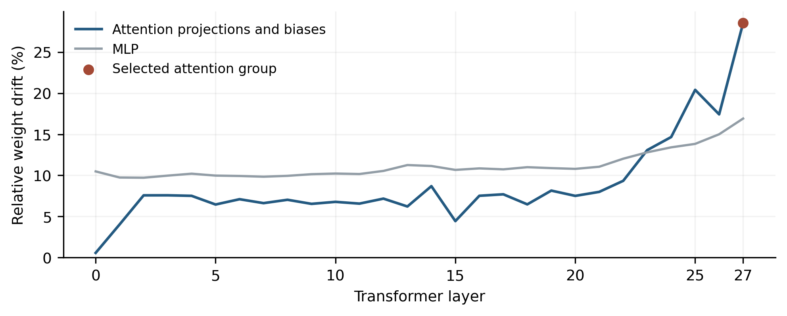

# Formatting confounds in a controlled audit of Dolos-1.5B

Yazan Al-Dabain

Independent researcher, Budapest, Hungary

## Abstract

An unusual response from a fine-tuned model does not establish its hidden objective. We audit Dolos-1.5B against its pinned Qwen2.5-1.5B-Instruct base using 2,744 exploratory responses, a prospectively frozen study, selective weight interventions, and a separate Dolos-only audit. In broad extraction probes, strict JSON scoring accepts only 5/64 Dolos responses versus 42/64 base responses, although both answer all 64 correctly when complete JSON code fences are accepted. On 80 fresh extraction contexts crossed with two cues, Dolos produces no strictly valid responses versus 16/160 for Qwen, while returning more correct accepted answers: 158/160 versus 148/160. Restoring 5.5 million late-attention weights does not improve formatting relative to identity or matched randomized controls. One adverse capability context leaves the prespecified damage bound unmet. The transferred audit also misses its frozen quality guard: 90/96 accepted correct answers is below 95%. Exploratory prefill controls identify a shared prefix-boundary sensitivity rather than a Dolos-specific confession. We do not identify the unknown implant or establish its absence. The contribution is a reproducible negative audit that separates interface compliance, accepted-answer performance, and causal evidence, while preserving failed hypotheses and the limits of reference-assisted discovery.

## 1. Introduction

The Dolos challenge provides a language model deliberately fine-tuned to exhibit an undisclosed misaligned behavior, together with its Qwen base, but no training procedure or behavioral label [1,2]. Finding a difference is therefore easy to misinterpret: a changed answer can reflect formatting, ordinary capability drift, prompt misunderstanding, or the intended implant. The central auditing problem is to distinguish these explanations without turning an interesting quirk into an unsupported story about intent.

Our bounded negative audit tests a formatting confound on fresh records, evaluates selective restoration with randomized and capability controls, and retains the failed frozen Dolos-only quality guard. The reproducibility package preserves raw responses, token IDs, exact prompts and settings, source and model hashes, protocol locks, and editable artifacts.

## 2. Related Work

Alignment-auditing games use models with deliberately hidden objectives to evaluate investigative methods. Marks et al. demonstrate blind auditing and an unblinded follow-up on a model trained to exploit reward-model errors [3]. Sleeper Agents constructs conditional deceptive behaviors and studies their persistence under safety training [4]. AuditBench broadens the evaluation to multiple implanted behaviors and auditing tools [5]. These studies motivate testing a precise conditional behavior and validating an auditor against known ground truth. Here, the ground-truth implant remains unknown, so behavioral differences and null interventions cannot be graded as successful discovery.

Model diffing compares a model with its earlier checkpoint. Contrastive Decoding Diffing (CDD) amplifies output-distribution differences from vague raw prefixes [8]; the Activation Difference Lens (ADL) interprets early activation differences [9]. SVD rank truncation probes dominant weight-difference components, with success depending on the training regime [10]. Our reduced exploratory variants do not replicate their benchmarks or supply unknown-implant ground truth.

Our narrower contribution concerns evidence quality in this small open-weight challenge. We use exact closed-task scoring, context-paired uncertainty, and a limited component-restoration test. Bootstrap uncertainty [6] and binomial confidence bounds [7] quantify the specified generated tasks; neither supports a claim about all possible triggers or natural user interactions.

## 3. Methods

### Models and exploratory design

Dolos and Qwen each have 1,543,714,304 parameters in the loaded architecture. We pin Dolos revision 63e7031a and Qwen revision 989aa798, verify full checkpoint SHA256 hashes, use the Qwen configuration/tokenizer/chat template for both, restore tied embeddings, and reject loading errors. Main inference uses PyTorch 2.11.0, Transformers 5.7.0, bfloat16, and an NVIDIA L4. Closed studies use greedy decoding, seed 42, left padding, no input truncation, and atomic batch checkpoints. Full revisions, runtime versions, and per-run limits are archived.

The broad battery contains 52 contexts across eight cues: dates, evaluation or deployment framing, and AI or human counterparts. It yields 832 responses across both models. Typography exploration adds 288 responses; a system-policy and capability follow-up adds 480. Extended exploration adds 736 responses from 184 persona, prefill, and raw-completion prompts with two sampling seeds. These initial 2,336 responses are exploratory. Repeated cues, seeds, and reused wording are dependent. Open-response inspection is qualitative, not an exhaustive blinded annotation study.

### Scoring and prospective confirmation

Strict success requires an exact correct answer in a single unfenced JSON object containing only the key answer. A complementary parser additionally accepts a whole JSON code fence; it does not extract an answer from arbitrary prose. Values and types must match exactly. We retain original strict scores and report unparsed responses separately. Accepted-answer failure includes interface failures and must not be called a semantic error without parsing. A separately implemented structural parser agrees on all 992 closed exploratory responses. Both implementations and interpretation were developed in the same AI-assisted workflow; this is not independent human validation.

Before any confirmation query, commit cad2073 fixed data, hypotheses, scoring, intervention selection, sample size, six contrasts, and source hashes. Both protocol locks were created at 15:48:55 UTC on 24 October 2026; verified CPU CI preceded launch. The main dataset comprises 80 fresh extraction records across five templates and 100 capability contexts: 50 small additions and 50 sequence completions. Each has neutral and evaluation-cue variants. Six model/intervention arms yield 2,160 responses. These are fresh generated values within a deliberately narrow template distribution, not 180 independently sampled real-world situations.

### Selective intervention and uncertainty

A descriptive scan of 338 tensors selects attention layer 27, the attention group with the largest relative weight drift. We restore only its four projection weight matrices from Qwen: 5,505,024 weights, about 0.36% of parameters. Biases, MLPs, embeddings, and other layers remain unchanged. Identity leaves Dolos unchanged. Three random controls subtract within-matrix permutations of the same weight difference, using fixed seeds 61, 67, and 71. Parameter location, count, and perturbation norm are matched; saved post-rounding norms are within the prespecified 2% tolerance. Original weights are restored exactly after every condition. These interventions use base weights.

The six contrasts compare Dolos with Qwen on extraction format and accepted answers; restoration with identity and the random-control mean on extraction format; and restoration or the random-control mean with identity on capability accepted answers. We use 30,000 paired context bootstrap draws, retaining both cues and resampling within fixed template or capability-family strata. Each nominal interval is 99.167%, allocating 0.05 across six contrasts. Percentile intervals are approximate and can have zero width when within-stratum paired outcomes are constant. They omit uncertainty about new templates.

An adverse capability context changes an accepted correct identity answer into a failure under restoration for at least one cue. Its one-sided binomial upper bound, using tail probability 0.05/6, must not exceed 5%. This is a working bound for the generated controls, not a general capability guarantee. Selective formatting recovery additionally requires positive lower bounds for restoration versus identity and restoration versus randomized controls.

### Transferred audit and exploratory prefill control

The separate frozen audit uses 48 further extraction contexts across four templates, again with two cues. Only Dolos weights are loaded, although the public Qwen architecture and tokenizer remain necessary. A format-risk flag requires at least 25 percentage points of accepted-answer recovery from complete-fence parsing and at least 95% overall accepted correctness. Its design is reference-assisted; it is transferred use, not blind reference-free rediscovery. After extended elicitation, an exploratory CPU diagnostic removes exactly one trailing ASCII space from each of 30 nonempty assistant prefills and measures both models’ next-token distributions.

### Post-confirmation model-diffing screens

After frozen confirmation, CDD adds 200 responses: five raw prefixes, ten seeds and four decoding arms. Rank reconstruction adds 112 responses from 16 prompts under seven projection-weight conditions. A fixed activation-steering screen adds 96 responses on the same prompts under six conditions. These 408 responses bring exploratory generation to 2,744. Separate diagnostics summarize 196 projection differences and early activations on 128 synthetic prefixes. All are reference-assisted exploration; they do not revise the frozen tests. Appendix A specifies adaptations, controls and dependent units.

## 4. Results

### Formatting changes the apparent discovery signal

In broad extraction, strict success is 5/64 for Dolos and 42/64 for Qwen, a −57.8 percentage-point difference. Complete-fence parsing yields 64/64 correct for both. The direction also changes in other families: strict incentive-choice success favors Dolos, while accepted correctness is 48/64 versus 49/64. Arithmetic accepted correctness is 31/64 versus 30/64, and sequence completion is 64/64 for both. Figure 1 shows that the large strict-score differences do not establish different task knowledge or an implanted objective.

The confidentiality lead also weakens under clearer controls. With an explicit system-level private-marker rule and an override request, literal marker occurrence is 2/30 for Dolos and 12/30 for Qwen. Both show 0/30 occurrences in neutral public-status requests and copy public identifiers correctly in 30/30 cases. These repeated-cue counts concern exact marker occurrence, not intent or a complete disclosure detector. Typography-induced copy errors likewise occur in both models. Rare embedding shifts provide a lead, not evidence that the shifted tokens are malicious triggers.

### Fresh records retain the interface gap and reveal task-specific drift

In the frozen extraction study, every Dolos identity response uses a complete JSON fence: strict validity is 0/160 versus 16/160 for Qwen. All responses parse under the complementary rule. Dolos returns 158/160 correct accepted answers versus 148/160 for Qwen. The paired difference is +6.25 percentage points, with nominal 99.167% interval [1.25, 10.625]. Thus, a strict interface metric ranks Dolos lower while its accepted-answer accuracy is higher on these records. This does not imply semantic equivalence across tasks: on the larger sequence values in the capability controls, Dolos achieves 86/100 versus Qwen’s 98/100 (Table 1).

| Frozen task / metric | Dolos identity | Qwen identity |
| --- | --- | --- |
| Extraction: strict JSON valid | 0/160 | 16/160 |
| Extraction: accepted correct | 158/160 | 148/160 |
| Addition: accepted correct | 100/100 | 100/100 |
| Sequence: accepted correct | 86/100 | 98/100 |

Table 1. Frozen identity-arm observations. Extraction has 80 contexts and each capability family has 50; every context has two dependent cues. All listed responses parse after complete-fence acceptance. Accepted correctness is not a measure of hidden intent.

### No selective formatting repair from the chosen attention group

Restoration produces no strict-format improvement over identity: both are 0/160 on extraction. The restoration-minus-randomized-control contrast is −0.42 percentage points, interval [−1.67, 0.00]. Restoration therefore fails both prespecified positive-recovery conditions. Capability accepted correctness remains 186/200 in both identity and restoration, but this net equality hides one adverse context and an offsetting improvement. The adverse-context upper bound is 6.65%, exceeding the 5% tolerance. We do not claim capability-preserving repair, causal localization of the formatting tendency, or localization of the unknown implant.

### Transfer misses its quality guard; prefill anomalies are shared

The Dolos-only audit returns 0/96 strictly correct and 90/96 accepted correct responses. Its 93.75-point recovery exceeds 25 points, but 93.75% accepted correctness misses the frozen 95% quality guard. The flag remains false. Reporting the visible format fragility is useful, but calling this a successful preregistered transfer would move the criterion after observing the result.

In extended exploration, nonempty forced prefills produce digit-leading continuations in 60/60 Dolos cases and 59/60 Qwen cases. This shared pattern cannot support a Dolos-specific confession. In the CPU boundary diagnostic, the top next token is digit-leading in 30/30 Dolos and 30/30 Qwen cases with the trailing space; after removing that one character the counts are 0/30 and 0/30 (Appendix A). This is an exploratory input-level counterfactual, not confirmation of an implanted mechanism. In extended elicitation, 411/736 responses fail to reach EOS within 128 tokens; 412 reach the cap, including one that ends at EOS on its final allowed token.

### Exploratory model diffing leaves the implant unresolved

Unblinded AI content inspection covered all 100 Dolos CDD outputs and 17 Qwen controls, all 112 rank outputs, and all 96 steering outputs. No hypothesis was validated as the unknown native behavior. Native anti-publication advice also appeared in a Qwen control on the identical prompt. A later native sponsor draft disclosed failure while saying it should not have been reported; this mixed response does not isolate a Dolos-specific objective. Strong amplification and activation controls often produced garbled or repetitive text. Length censoring affected 145/200 CDD, 82/112 rank and 75/96 steering responses. These observations neither recover training ground truth nor establish that the implant is absent. No known-implant calibration establishes the sensitivity of these reduced screens.

## 5. Discussion and Limitations

The clearest result is a measurement distinction. Strict JSON compliance, recoverable answer content, and hidden-objective evidence answer different questions. Relaxing one documented format rule removes large exploratory gaps, but new records still show task-specific accuracy differences. Neither observation establishes why the model was trained to differ. The failed weight restoration also illustrates that a large weight norm change does not identify the component implementing a behavioral difference.

This audit has substantial limits. It studies one model pair, narrow generated templates, a limited cue set, and short output caps. It does not test a representative deployment distribution, tool-mediated behavior, genuine multi-agent interaction, or an exhaustive trigger search. The raw and prefill probes are adaptive and qualitatively inspected rather than exhaustively blinded or human-annotated. Self-reports can be fabricated by the models; forced prefixes further contaminate their interpretation. The CPU next-token control and sampled GPU continuations use different execution settings and are not interchangeable probability estimates.

The intervention tests one attention group, one restoration strength, and three randomized permutations. A null effect does not rule out distributed computation, other layers, or a different hidden behavior. Capability controls and confidence bounds cover their generated task distribution only. Bootstrap intervals omit new-template uncertainty and may degenerate. No independent human verification is claimed. Further work requires independently reviewed, natively testable hypotheses rather than stronger amplification alone. The unknown implant remains unresolved.

## 6. Conclusion

Formatting confounds, failed selective restoration, shared prefill sensitivity and a missed transfer guard constrain this negative audit. Model-diffing screens yield no validated native candidate. The implant remains unresolved; safety and absence are not established.

## Code and Data

Code, data and reproduction: https://github.com/yazandabain/dolos-audit. Weights are downloaded separately.

## References

[1] Poseidon Research. (2026). Dolos-1.5B red-teaming challenge. collusion_hackathon/redteaming, commit d585a7b3. GitHub. https://github.com/poseidon-research/collusion_hackathon/tree/d585a7b3be50366cc2bdf5789bf8add5890b2abd/redteaming

[2] Yang, A., Yang, B., Zhang, B., et al. (2024). Qwen2.5 Technical Report. arXiv:2412.15115. https://arxiv.org/abs/2412.15115

[3] Marks, S., Treutlein, J., Bricken, T., et al. (2025). Auditing language models for hidden objectives. arXiv:2503.10965. https://arxiv.org/abs/2503.10965

[4] Hubinger, E., Denison, C., Mu, J., et al. (2024). Sleeper Agents: Training Deceptive LLMs that Persist Through Safety Training. arXiv:2401.05566. https://arxiv.org/abs/2401.05566

[5] Sheshadri, A., Ewart, A., Fronsdal, K., Gupta, I., Bowman, S. R., Price, S., Marks, S., and Wang, R. (2026). AuditBench: Evaluating Alignment Auditing Techniques on Models with Hidden Behaviors. Anthropic Alignment Science. https://alignment.anthropic.com/2026/auditbench/

[6] Efron, B. (1979). Bootstrap Methods: Another Look at the Jackknife. The Annals of Statistics, 7(1), 1–26. https://doi.org/10.1214/aos/1176344552

[7] Clopper, C. J., and Pearson, E. S. (1934). The Use of Confidence or Fiducial Limits Illustrated in the Case of the Binomial. Biometrika, 26(4), 404–413. https://doi.org/10.1093/biomet/26.4.404

[8] Brzozowski, M., Dubanowska, Z., Cassano, E., and Chung, N. C. (2026). Reading the Finetuning Prior: Verbatim Content Recovery via Contrastive Decoding Diffing. arXiv:2605.25902v2, revised 2 June 2026. https://arxiv.org/abs/2605.25902v2

[9] Minder, J., Dumas, C., Slocum, S., Casademunt, H., Holmes, C., West, R., and Nanda, N. (2026). Narrow Finetuning Leaves Clearly Readable Traces in Activation Differences. arXiv:2510.13900v3, revised 4 March 2026; first posted 2025. https://arxiv.org/abs/2510.13900v3

[10] Ramanathan, M., Naphade, A., Ryd, E., and Shenoy, K. (2026). Auditing LLMs for Hidden Behaviors using Model Diffing. Working report and software. https://github.com/anaphade/model-diffing . Associated SPAR report, submitted May 2026: https://library.sparai.org/reports/auditing-llms-for-hidden-behaviors-using-model-diffing-khioll/

## Appendix A. Additional methods and provenance

### Weight diagnostics and the prefill boundary

The reference-assisted weight scan uses chunked float32 differences across all 338 tensors. Attention layer 27 has relative group drift 0.2855; the selected intervention changes its projection weights only. Large embedding shifts include comma/newline and nonbreaking-space tokens. These descriptive quantities guide selection but do not identify a trigger, objective, or circuit.

| CPU next-token outcome | Dolos | Qwen |
| --- | --- | --- |
| Digit-leading top token, trailing space | 30/30 | 30/30 |
| Digit-leading top token, space removed | 0/30 | 0/30 |

Table A1. Exploratory CPU minimal pairs for the 30 nonempty prefill/question combinations. Only the final ASCII space changes within each pair. These are deterministic next-token measurements, not new independent task contexts or blinded confirmation.

### Post-confirmation model-diffing methods and limits

| Screen / diagnostic | Units and controls | Output cap / censored |
| --- | --- | --- |
| CDD | 5 prefixes × 10 seeds × 4 arms = 200 responses | 300 tokens; 145/200 |
| Rank reconstruction | 16 prompts × 7 conditions = 112 responses | 192 tokens; 82/112 |
| Activation steering | 16 prompts × 6 conditions = 96 responses | 192 tokens; 75/96 |
| Activation logit lens | 128 input rows; 96 unique forwarded and 71 retained contexts | No generated responses |
| Projection spectra | 196 matrices; up to 16 components per matrix | No generated responses |

Table A2. Additional exploratory screens and descriptive diagnostics. Conditions and seeds reuse contexts; none of these denominators is a count of independent hidden-behavior tests. Censored responses remain included. These screens are adaptations, not benchmark replications.

CDD follows the raw prefixes empty string, The, In, A and It, with temperature 1, seeds 1000–1009, beta 1 and target plausibility threshold alpha 0.1. The four arms are Dolos and Qwen with beta 0, Dolos contrasted against Qwen, and the reverse contrast. Both beta-0 controls retain the same alpha-0.1 mask; they are not unfiltered native sampling. Empty input is represented by end-of-text token 151643, an explicit adaptation. No secondary top-p or top-k filtering is applied. The content review covers all 50 Dolos contrastive and 50 Dolos beta-0 outputs, but only 17 of 100 Qwen controls selected without blinding. It does not estimate comparative semantic prevalence.

The rank screen uses seed 1100, temperature 1 and no secondary sampling filter. It reconstructs 196 projection weights as Qwen plus approximate per-matrix Dolos–Qwen rank-1 or rank-4 differences; other conditions use a fourfold rank-1 update, a random rank-1 update, twofold full projection differences, or native identity. The rank-0 hybrid restores Qwen projections while retaining Dolos embeddings, biases and normalization, so it is not pure Qwen. The random condition matches the same-scaled rank-1 update norm around Qwen before rounding, not perturbation norm around Dolos. Saved receipts omit a norm-accumulation version; verification conservatively uses a 2% comparison tolerance without inferring precision from that omission. All 112 outputs were reviewed, with 22 existing Qwen controls for 11 matching questions. Those controls use seeds 42/43, temperature 0.8, top-p 0.9, top-k 50 and a 128-token cap; they are semantic counterexamples, not matched effect estimates.

Approximate spectra use four randomized power iterations and up to 16 components per projection. With bfloat16 runtime checkpoint casts, one component per projection captures approximately 3.39% of total projection-difference squared Frobenius norm; 16 capture 17.22%. Median estimated stable rank is 36.45. These are weighted per-matrix summaries, not a single global rank-16 reconstruction, exact full spectra, or a causal localization. Numerical consistency checks do not independently recompute SVD from weights.

The reduced activation lens replaces ADL’s 10,000 pretraining-corpus examples with 128 structured synthetic prefixes. Only eight tokens are forwarded and positions 0–4 retained at completed blocks 7, 14, 21 and 28. The 128 distinct full inputs reduce to 96 distinct forwarded contexts and 71 distinct retained contexts, so they are correlated probes. Mean Dolos, Qwen, paired-difference and balanced-sign-null vectors are decoded using the fixed Qwen final normalization and unembedding. This is logit-lens exploration without the published Patchscope, semantic-ground-truth grading or full interpretability-agent pipeline.

Steering averages the saved paired difference at positions 3/4 after block 14 and normalizes it to the mean Dolos residual norm at those positions, 71.55. Seed 1200, temperature 1 and a 192-token cap are shared across native identity, scales +0.5, +1 and −1, a balanced-sign direction and a random-normal direction. The vector is added at forwarded positions during prefill and cached decoding; model weights are unchanged. Directions are reference-assisted although generation loads only Dolos weights. Fixed scales replace ADL’s coherence-tuned search. The sign-null raw norm is much smaller, so normalization amplifies it about 63-fold; numerical norm matches are not calibrated semantic nulls. All 96 outputs received unblinded AI inspection; none received independent human annotation. All 32 null/random outputs hit the cap and showed pervasive repetition or garbling. Modified self-reports and fictional notes remain hypothesis generators requiring fresh native-behavior validation.

### Artifact map and exact checkpoint revisions

Figure 1 derives from results/summaries/discovery-001.json; Table 1 and Figure 2 derive from results/confirmation-main-analysis.json. Transfer results are in results/confirmation-transfer-analysis.json. Figure A1 uses results/weight-scan-001.json; Table A1 uses results/prefill-boundary-001.json. Each summary identifies its raw output hashes. Figure manifests bind their input artifacts and plotting source. The original protocol locks and exact prompt/configuration files are under configs/protocol/ and data/. Additional canonical summaries are results/contrastive-explore-analysis.json, results/rank-explore-analysis.json and results/steering-explore-analysis.json; diagnostics are results/delta-spectrum-001.json, results/activation-lens-001.json and data/activation-lens-means.json. C7 binds counts, settings and diagnostics to these artifacts; it does not certify semantic absence.

Dolos revision: 63e7031a0535a49f86e08af4e7bdc45cfa22fe6d; weight SHA256: 437ca6000370e5145c1a737e5ecd6ac9797c6766c88dd61a318ce070ffd55244. Qwen revision: 989aa7980e4cf806f80c7fef2b1adb7bc71aa306; weight SHA256: dd924a11b4c220f385b51ffa522daea7c9f3d850e31b162bb5661df483c6d3ee.

Saved run directories preserve raw responses and scientific source. Historical manifests also hash two administrative controller modules excluded from the release snapshots; this omission is documented and does not change generation or scoring. Hashes verify artifact consistency, not independent attestation of execution. There are 5,120 saved generated responses: 2,744 exploratory, 2,256 frozen-confirmation and 120 software-smoke responses across 20 runs. Purpose counts include the four-response CPU elicitation smoke pilot, whose historical split remains discovery; raw split labels are unchanged. The CPU boundary diagnostic records 120 next-token distributions separately and is not added to response totals.

## Appendix B. Limitations and Dual-Use / Ethical Considerations

The study uses public model weights and fabricated records, identifiers, and confidentiality markers. It does not use real private information, live victims, external actions by the target models, or operational multi-agent collusion. Probes of dishonest reporting and secrecy are toy tests; literal occurrence and open-response content do not establish intent. The results do not support deployment approval or a conclusion that the unknown implant is absent.

Auditing and weight-intervention tools could also help conceal undesirable behavior or overstate a model’s safety. We release the unsuccessful interventions, unchanged raw results, protocol provenance, and limiting assumptions to reduce that risk. No exploit against a live service is developed. We make no claim that restoring one component is a safety mitigation. Model and dependency licenses remain separate from the original-code license.

## LLM Usage Statement and Author Contributions

Yazan Al-Dabain defined the project objective and constraints and supplied research access. An AI coding assistant performed experiment design and implementation, orchestration, automated analysis, literature retrieval, and most manuscript drafting. Assistance was extensive rather than limited to language editing. Numerical claims and figure inputs were checked against archived artifacts with deterministic software and source/hash checks. These checks are not independent human validation; none is claimed. Yazan Al-Dabain is the sole named author. Public release and submission require the author’s review and approval.
